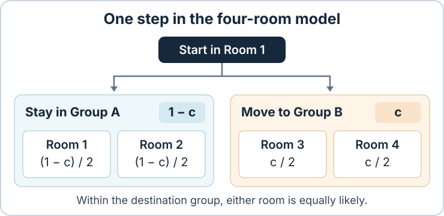

# Eigenvalues and Network Equilibrium

Exploratory Python tools for asking how spectral gap, network structure and starting distribution relate to convergence in small Markov chains. Uses NumPy, Matplotlib and pytest, with deterministic probability propagation.

**AI-assisted exploratory software. Instructor approval for assessed use has not been recorded.** Read [ACADEMIC_INTEGRITY.md](ACADEMIC_INTEGRITY.md) before proposing calculations or figures for graded work. This repository contains computational tools and experiment designs. The separately maintained manuscript and learning notes are outside this repository.

## Four-room model



The diagram shows the first row of the [four-room transition matrix](src/network_models/matrices.py) used in the baseline and starting distribution experiments.

## Run locally

Python 3.13 is the tested environment. Clone the repository and run:

```sh
git clone https://github.com/stevenchenjy/eigenvalue-network-equilibrium.git
cd eigenvalue-network-equilibrium
python3 -m venv .venv
source .venv/bin/activate
python -m pip install -r requirements-lock.txt
python -m pytest -q
python run_experiment.py --config experiments/baseline/config.json
```

On Windows, activate the environment with `.venv\Scripts\Activate.ps1` in PowerShell. The launcher loads the current `src/` directly; no editable installation is required. requirements-lock.txt pins the initial tested dependencies. requirements.txt defines compatible ranges for environments requiring different versions; test any such environment and retain its version record. Source syntax requires Python 3.10+, while the lock may require a newer interpreter.

## Exploratory experiments

| Configuration | Controlled question | Default cases |
|---|---|---:|
| [Baseline](experiments/baseline/README.md) | Change cross-group probability in the four-room model | 7 |
| [Starting distributions](experiments/starting_distributions/README.md) | Change the initial distribution with a fixed matrix | 4 |
| [Network structures](experiments/network_structures/README.md) | Compare small reversible models with shared distance, threshold and node count | 13 matrices × 4 starts |
| [Spectral-gap limits](experiments/spectral_gap_limits/README.md) | Change the threshold under fixed matrix/start controls | 6 |

```sh
python run_experiment.py --config experiments/starting_distributions/config.json
python run_experiment.py --config experiments/network_structures/config.json
python run_experiment.py --config experiments/spectral_gap_limits/config.json
python run_experiment.py --help
```

Use `--run-id NAME` for a named run; existing IDs are refused. `--output-root PATH` selects an output location. Optional c>0.5/periodic-endpoint checks and a directed-ring model are separately configured and enabled with `--include-optional` on the relevant configuration. Their extra assumptions should be studied before interpretation.

## Conventions

- P is row-stochastic: P[i,j] is the probability of next node j given current node i. Distributions are row vectors; `p_next = p @ P`.
- The stationary distribution is a left eigenvector satisfying `pi @ P = pi`. Its existence does not imply convergence from every start.
- Main simulations require finite, irreducible, aperiodic chains. Nonergodic inputs receive explicit diagnoses; hitting an iteration limit never invents a convergence time.
- SLEM is the largest remaining eigenvalue modulus after removing exactly one eigenvalue near 1. The absolute spectral gap is `1 - SLEM`, including negative and complex eigenvalues.
- Default convergence time is the first t≥0 with L1 distance **strictly less than 0.001**. The initial state is checked at t=0. This is a specified-start first-passage time, not a formal worst-case mixing time.
- TV distance is available as half L1. Consistent comparisons must use consistent metrics and thresholds.

See [numerical conventions](docs/numerical_conventions.md) for tolerances, structural support, conditioning checks, and the labeled display floor used on logarithmic plots. Spectral gap is not asserted to give an exact finite-time formula for arbitrary networks.

## Source and outputs

```text
src/network_models/   Models, diagnostics, spectra, propagation, experiments, plots
tests/                Analytical reference checks, edge cases, CLI/export checks
experiments/          JSON configurations and construction/control descriptions
docs/                 Numerical conventions, software origin, approval checklist
outputs/              Generated local data, figures and run receipts (Git-ignored)
```

Each run writes summary/trajectory CSVs and complete input metadata under `outputs/data/<run-id>/`, labeled PNGs under `outputs/figures/<run-id>/`, and its actual command/configuration, runtime versions, source hashes and artifact hashes under `outputs/logs/<run-id>/`. Keep the complete run folders together for independent checking. Run metadata contains local paths, so inspect and redact it deliberately before any separate sharing.

The reproducibility target is identical numerical trajectories/tables for identical inputs on the same recorded environment. Run IDs/timestamps differ, and cross-platform floating-point or font differences remain possible. Generated data and figures are excluded from this repository by default.

## Verification and provenance

The initial computational implementation has 103 automated validation cases covering known four-room reference values, strict thresholds, stationary starts, negative/complex spectra, invalid or nonergodic matrices, numerical conditioning, repeatability and exported evidence. Run the suite locally to verify your checkout. [GitHub Actions](https://github.com/stevenchenjy/eigenvalue-network-equilibrium/actions) runs tests and a baseline smoke run on Python 3.13.

[Software origin](docs/software_origin.json) records hashes of the initial extraction inputs and AI assistance. The Git commit identifies each published code version. The original research workspace retains its historical prototypes and run receipts; ongoing software development belongs in this standalone coding repository. Instructor permission, student-independent mathematical checks, and independently authored conclusions remain separate requirements.
